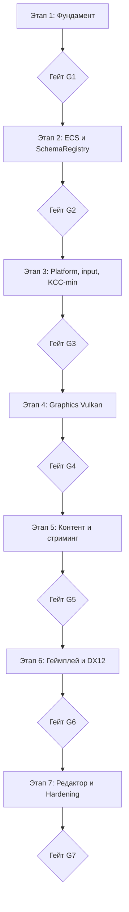

# FluxEngine — Roadmap разработки

Детальный пошаговый план реализации на основе [architecture.md](architecture.md),
[canon.md](canon.md) и [adr/README.md](adr/README.md).

> **Источник истины — этот файл.** SPA читает его напрямую (`?raw`), копий
> нет. Числовые пороги гейтов хранятся только здесь.

## Как читать этот документ

Иерархия работ: **этап → рабочий пакет (WP) → задача**. Задача — чекбокс,
который нельзя закрыть без выполнения критерия приёмки пакета.

- **WP** (work package) — логически неделимый кусок работы с одним результатом.
- **Критерий приёмки** — проверяемое условие («что должно быть истинно»),
  а не «код написан».
- **Майлстоун** `M<n>` — демонстрируемый сценарий: что можно показать в конце этапа.
- **Гейт** `G<n>` — измеримый переход к следующему этапу. Гейт не пройден —
  следующий этап не начинается.
- **Вход/выход этапа** — явные предусловия и артефакты.

Оценок в часах и днях нет намеренно: движение по гейтам, а не по датам.

## Принципы выполнения

1. **Вертикальные мини-срезы**: каждый этап заканчивается работающим
   майлстоуном, а не «крейт готов».
2. **Гейты**: измеримые критерии перехода (бенчмарки, CI-гейты, демо).
   Гейт не пройден — следующий этап не начинается.
3. **ADR-дисциплина**: изменения по триггерам из [adr/README.md](adr/README.md)
   — до кода, тем же PR.
4. **Заделы этапа 1 обязательны**: UUID полей, SchemaRef/schema_rev,
   SimTime-компонент, breadcrumbs — форматы после появления данных менять нельзя.
5. **Детерминизм-харнесс** (боты, сверка хешей) — гейт с этапа 3 навсегда.
6. **Один этап — один набор гейтов**: нельзя «доложить» часть этапа и начать
   следующий параллельно.
7. **Внутри этапа параллелизм разрешён** только между независимыми WP
   (см. «Параллелизм внутри этапов»).

## Definition of Ready (задача готова к работе)

- [ ] Предыдущий гейт зелёный (для первой задачи этапа).
- [ ] Триггер ADR проверен; при триггере ADR смержен до кода.
- [ ] Критерий приёмки сформулирован измеримо (тест, бенч, демо).
- [ ] Зависимости (крейты/типы/форматы) существуют и не меняются в этом же PR.
- [ ] Понятно, какой гейт или инвариант задача защищает.

## Definition of Done (пакет закрыт)

- [ ] Код + юнит-тесты; для инварианта — property/regression-тест.
- [ ] Публичный API имеет doc-комментарий с контрактом.
- [ ] Нет `unwrap` в lib; ожидаемые отказы — `Result`.
- [ ] Для горячего пути — бенчмарк и отсутствие регрессии бюджета.
- [ ] Канон/контракты обновлены, если изменились имена/форматы.
- [ ] Чекбокс в этом файле обновлён в том же PR.

## Граф зависимостей этапов

## Сводка этапов

| # | Цель | Крейты | Майлстоун | Гейт | Зависит от |
|---|---|---|---|---|---|
| 1 | Каркас, на котором всё собирается | flux-math, flux-core, flux-engine | M1 | G1 | — |
| 2 | Сердце данных, проверенное бенчмарком | flux-ecs | M2 | G2 | G1 |
| 3 | Окно/ввод и первая живая симуляция | flux-platform, flux-physics (min) | M3 | G3 | G2 |
| 4 | Рендер-стек до PBR-качества | flux-graphics | M4 | G4 | G3 |
| 5 | Контент-пайплайн и мир с partition | flux-asset, flux-scene, flux-net (loopback), flux-build | M5 | G5 | G4 |
| 6 | Играбельные подсистемы + DX12 | physics, anim, ai, script, audio, ui, net (UDP) | M6 | G6 | G5 |
| 7 | Инструменты и эксплуатационная готовность | flux-editor, flux-build (shipping), net (topology) | M7 | G7 | G6 |

---

## Этап 1 — Фундамент: workspace, flux-math, flux-core, цикл

**Цель**: каркас, на котором всё остальное собирается и тестируется.

| Параметр | Значение |
|---|---|
| Вход | Пустой репозиторий, ADR-0001…0027 приняты |
| Крейты | flux-math, flux-core, flux-engine (+ заготовки остальных) |
| Выход | M1 + G1 |
| Риск этапа | заделы форматов (UUID полей, SchemaRef, SimTime) сделать поздно |

### 1.1 Workspace-скелет

- [x] Root `Cargo.toml`: members по канону, `[workspace.dependencies]` (единые версии),
      `panic = "unwind"` в профилях, feature-гейты (`vulkan`/`dx12` — flux-graphics,
      off по умолчанию для скорости сборки)
- [x] Крейты-заготовки по канону: 16 крейтов + tools/flux-assetc + tools/flux-build
      (18 единиц канона; структура модулей из canon.md, lib.rs с `// TODO(этап N)`)
- [x] Крейтовые линты: `clippy::unwrap_used = deny` на lib, workspace-level lints
- [x] README в каждом крейте: ссылка на канон + ответственность одной строкой
- [x] `rust-toolchain.toml` (stable + MSVC), MSRV зафиксирован, `.gitattributes`
      (LF для исходников), `rustfmt.toml`, `deny.toml`
- [x] `.gitignore`: `target/`, `docs/spa/node_modules/`, кэши PSO/DXC

**Приёмка**: `cargo metadata --no-deps` выводит ровно именованный перечень
канона (16 крейтов + 2 инструмента + flux-macros); ни одного лишнего пакета.
`cargo build --workspace` зелёный без Vulkan SDK; `cargo deny check` проходит.

### 1.2 CI-скелет (CPU-only раннер)

- [x] fmt + clippy + юнит-тесты на каждый push в `dev`
- [x] Кэш cargo между ранами
- [x] Headless-зависимостный линтер: lib-крейты не тянут winit/ash/gilrs (проверка графа)
- [x] Артефакты падений (логи) — автоматичны
- [x] Док-линт: `node docs/scripts/check-links.mjs` + сборка SPA (`docs.html` в корне)
- [x] Сборка release-профиля после тестов, версионирование и авто-merge
      `dev` → `master` (fast-forward) с GitHub Release
- [x] Issue при красном CI на `dev` (создание/комментарий без дублей)
- [ ] Защита `master`: обязательный зелёный CI, запрет force-push,
      push только от `github-actions[bot]`. Внешняя настройка GitHub: нужен
      первый пуш workflow и права админа; параметры и команда —
      `docs/ci-cd.md` §1.1

**Приёмка**: PR с намеренным `unwrap` в lib и с битой ссылкой в docs краснеет
по соответствующему шагу; повторный прогон генератора не меняет файл.

### 1.3 flux-math

- [x] `types.rs`: re-export glam (default-features=false, libm), Vec3 vs Vec3A
      (align-контракт), DVec3/DQuat
- [x] `WorldPos(i64 x3)` — канон, нанометры; конверсии канон↔f32/f64
      (checked/saturating, без тихой потери точности)
- [x] `SimRegion` + детерминированный rebase: функция переноса origin,
      инварианты на границах тиков
- [x] Фрустум/AABB/OBB/Sphere, BVH-заготовка (для picking этапа 7)
- [x] Юнит-тесты: точность конверсий, детерминизм операций на libm, align-тесты
- [ ] Бенчмарки конверсий и rebase (бюджет — «Потоки вне этапов»)

**Приёмка**: roundtrip `WorldPos → sim → WorldPos` в пределах допуска; 10k
последовательных rebase не накапливают дрейф; тесты падают при подмене libm на SIMD.

### 1.4 flux-core MVP

- [x] `time/`: Clock, FixedTimestep (аккумулятор, анти-spiral N), TimeContext,
      Stopwatch; SimTime-компонент-тип (задел №24)
- [x] `memory/`: FrameArena (кольцо), GenerationalIndex/SlotMap, PoolAllocator,
      трекинг по тегам (debug), OOM-политика
- [x] `events/`: EventRegistry (типизированные очереди, Reader/Writer,
      отложенные на кадр, once-события)
- [x] `jobs/`: воркеры N-1, work-stealing (crossbeam-deque), JobHandle/JobCounter
      с зависимостями, scoped jobs, MainThreadTaskQueue, приоритеты,
      catch_unwind на воркере (статус Panicked, воркер живёт — №10)
      (MVP: JobCounter-зависимости, scoped jobs и приоритеты — этап 2+)
- [x] `logging/`: tracing-subscriber, каналы, Telemetry-lite (FPS, P99 frametime),
      assert/verify-макросы
- [x] `crash/`: контракт CrashHandler, единый паник-хук, breadcrumbs
      (lock-free ring) — задел №10; без WinAPI внутри core
- [x] `config/`: RON-секции, дефолты + валидация, ConfigChanged
- [ ] `platform/`: thread priority, affinity; DynamicLibrary; mmap-заготовка
      (MVP: приоритет потока и parallelism; affinity/DynamicLibrary/mmap — этап 2+)
- [x] `contracts/`: trait Platform (минимум), скелеты Renderer, AudioDevice,
      NetBackend, ScriptVM, RelevanceProvider — сигнатуры из плана

**Приёмка**: тик-цикл на FrameArena даёт 0 аллокаций после прогрева; паника в
job не роняет воркер и поднимает статус Panicked к корню; breadcrumbs доступны
из паник-хука; конфиг валидируется и рассылает ConfigChanged.

### 1.5 flux-engine скелет

- [x] `EngineBuilder::build()` (bootstrap-граф: config → logging → jobs → engine),
      `Engine { tick, frame, acquire }`, `run()`-обёртка (контракт ADR-0027)
- [x] Plugin trait + EngineContext-заготовка (доступ только через контракты)
- [x] `settings`: пользовательские настройки поверх config

**Приёмка**: цикл владеет вызывающий; `run()` — тонкая обёртка; плагин не видит
конкретные типы бэкендов.

### 1.6 Мини-срез «движок дышит»

- [x] Окно (winit), poll events, чистый рендер-стаб (clear color)
- [x] Job-параллельная работа: 2 параллельные системы на кадре через scheduler-стаб
- [x] Паника в job → catch → красный лог + breadcrumbs → кадр сброшен (№10 в действии)
- [x] Dev-overlay минимум: FPS, P99 frametime, число воркеров
      (пример `crates/flux-engine/examples/minimal.rs`)

**Приёмка**: окно открывается и закрывается без утечек; две системы реально
исполняются параллельно (проверяемо по логу потоков); паника в job не убивает процесс.

### 1.7 Заделы форматов (обязательно до данных)

- [x] Тип UUID поля компонента + генерация (фиксированный алгоритм)
- [x] `SchemaRef { type_uuid, schema_rev }` + сериализация
- [x] Маркеры `#[save]` / `#[replicated]` (заготовки макросов)
      (заготовка — `FieldFlags`/`ComponentLayout` в flux-core/schema;
      реальные атрибуты — вместе с `#[derive(Reflect)]`, этап 2)
- [x] `SimTime` как тип компонента (16 бит/сутки)
- [x] API breadcrumbs для подсистем

**Приёмка**: serde-roundtrip всех заделов; изменение ревизии схемы обнаруживается
тестом; формат зафиксирован ADR до появления первых сейвов.

### Майлстоун M1 — «движок дышит»

Демо: окно с clear-color; два параллельных job-а в кадре; паника в job не убивает
процесс; breadcrumbs видны в логе; dev-overlay показывает FPS и P99.

### Гейт G1

| Критерий | Метод проверки | Порог |
|---|---|---|
| Детерминизм аккумулятора | два прогона fixed timestep | одинаковые тики |
| Экономика кадра | трекинг FrameArena | 0 аллокаций после прогрева |
| Линты | CI | clippy/линты зелёные, 0 `unwrap` в lib |
| Документация | `node docs/scripts/check-links.mjs` | 0 битых ссылок, SPA собирается |

### Не делаем на этапе 1

ECS, реальный рендер-бэкенд, ассеты, физика, сеть. Только каркас и контракты.

### Риски этапа 1

| Риск | Митигация |
|---|---|
| Заделы форматов сделаны «потом» | WP 1.7 — обязательный, входит в G1 |
| Паника в job теряет контекст | breadcrumbs пишутся до раскрутки стека |
| Линты мешают прототипировать | allow на тестах/бенчах, deny только на lib |

---

## Этап 2 — flux-ecs: архетипы, SchemaRegistry, детерминизм-харнесс

**Цель**: сердце данных, проверенное бенчмарком.

| Параметр | Значение |
|---|---|
| Вход | G1 зелёный; заделы форматов из 1.7 |
| Крейты | flux-ecs, flux-macros (дерайвы) |
| Выход | M2 + G2 |
| Риск этапа | преждевременный параллельный планировщик до стабильных архетипов |
| Статус | **завершён** (I0–I5; M2 и G2 пройдены) |

### 2.1 Entity и World

- [x] Entity (index+generation), аллокатор слотов, запрет реюза generation
- [x] Спавн/деспавн, `spawn_batch`
- [x] Отложенные операции (`Commands`, WP 2.4) — `commands.rs`:
      `CommandTarget::{Existing, Deferred}`, применение на барьере стадии
- [x] Карта entity UUID ↔ Entity для сейвов/сети (UUID стабилен на всю жизнь)

**Приёмка**: 1M спавн/деспавн не растят память без предела; generation не
повторяется (property-тест); UUID не меняется при миграциях архетипа.

**Статус I1**: `crates/flux-ecs/src/entity.rs`, `world.rs`; 100k
спавн/деспавн — в CI, 1M — `#[ignore]` (release-only); property-тесты —
`crates/flux-ecs/tests/entity_props.rs` (модель мира, поколения, дыры).

### 2.2 Архетипы

- [x] SoA-таблицы: комбинация компонентов = таблица плотных столбцов
- [x] Миграции add/remove компонента, swap-remove, очистка пустых архетипов
- [x] Рост capacity без реиндексации чужих архетипов

**Приёмка**: миграция сохраняет значения всех компонентов; swap-remove не
оставляет дыр; пустой архетип удаляется.

**Статус I1**: `crates/flux-ecs/src/archetypes.rs` — `Signature` (256 типов),
`Chunk` (16 KiB, до 1024 слотов), `ComponentRegistry`; `Chunk::remove_slot`
для `despawn` и `Chunk::remove_entity_record` для миграций (столбцы уже
перенесены). Порядок компонентов — `ComponentIndex`, независимый от
`HashMap`.

### 2.3 Запросы и change detection

- [x] Query: With/Without, кэш архетипов по сигнатуре
- [x] Итерация по архетипам без виртуальных вызовов на элемент
- [x] Added/Changed через Tick (метка кадра)
- [x] Разбиение на батчи для будущего параллельного исполнения

**Приёмка**: изменение набора компонентов не инвалидирует несвязанные запросы;
Added/Changed не дают ложных срабатываний между тиками.

**Статус I2**: `query.rs` — `QueryKey`/`QueryCache` (`BTreeMap`, инвалидация по
`epoch` архетипов), `Query` (фильтры `added_since`/`changed_since`),
`QuerySpec` (`With`/`Without`), `QueryMut::for_each_batch` (батч 256 по
умолчанию). Метки — `Chunk::component_tick` параллельно каждому столбцу.
Property-тесты — `crates/flux-ecs/tests/query_props.rs`.

### 2.4 Commands и ресурсы

- [x] Отложенные команды (спавн/деспавн/insert/remove), применяются в конце фазы
- [x] Типизированные ресурсы мира

**Приёмка**: команда, созданная в системе, видна только после фазы; порядок
применения детерминирован.

**Статус I2**: `commands.rs` — FIFO-очередь `CommandTarget::{Existing, Deferred}`,
`Commands::apply` собирает `CommandsReport` (ошибки не прерывают очередь);
`resources.rs` — `Resources` + `World::{insert_resource, resource, resource_mut,
remove_resource}`.

### 2.5 Планировщик (однопоточный)

- [x] before/after зависимости, детерминированный порядок внутри stage
- [x] Явные барьеры фаз
- [x] Диагностика конфликтов read/write (для будущего DAG)

**Приёмка**: два прогона дают одинаковый порядок систем; конфликтующие системы
не попадают в одну фазу.

**Статус I3**: `scheduler.rs` — `Stage` (`INPUT`/`UPDATE`/`POST`), `Access`,
`SystemDescriptor` (before/after, `TickRate`), топосортировка Кана с тай-брейком
по имени, `ScheduleReport`/`StageReport`/`Conflict`, применение `Commands` на
барьере стадии. Property-тесты — `crates/flux-ecs/tests/schedule_props.rs`.

### 2.6 SchemaRegistry

- [x] `#[derive(Reflect)]`: type_uuid, поля с UUID, schema_rev
      (пакет flux-macros, ADR-0028; формат — ADR-0030)
- [x] `#[save]` / `#[replicated]` — реальные маркеры, а не заготовки
- [x] Метаданные для инспектора (тип, диапазон, enum-варианты)
- [x] RON debug-сериализация для тестов

**Приёмка**: ренейм поля не меняет UUID; смена типа требует новой ревизии;
схема восстанавливается из метаданных без кода поля.

**Статус I4**: `flux-macros::Reflect` — UUID типа/поля (детерминированный v5 или
явный), `#[save]`/`#[replicated]`, `#[field(uuid)]`, `#[reflect(min, max, slider,
category, tooltip, visible)]`; compile-fail — `tests/ui` (trybuild).
`flux-ecs::schema` — `FieldType`, `EditorMeta`, `OrphanPolicy`,
`ComponentSchema`, `SchemaRegistry` (конфликт ревизий, порядок по UUID).

### 2.7 SaveState-тип

- [x] Дельта: `entity_uuid + component_type_uuid + schema_rev + data`
- [x] Журнал дельт (append-only), формат с ревизиями
- [x] Политика orphaned-записей (явный лог, не молчаливая потеря)

**Приёмка**: сериализация/десериализация дельты roundtrip; запись старой ревизии
не ломает чтение (задел миграций).

**Статус I4**: `flux-ecs::save` — `Value`, `FieldValue`, `ComponentDelta`,
`JournalEntry`, `SaveJournal` (канонический порядок, RON roundtrip,
`OrphanedField` при неизвестном поле); `OrphanPolicy` — в схеме компонента.

### 2.8 SimTime как компонент

- [x] Тип, квантование 16 бит/сутки, детерминированное продвижение в тике
- [x] Харнесс потребляет SimTime сразу

**Приёмка**: два прогона дают одинаковое SimTime; значение попадает в дифф сейва.

**Статус I4**: `flux-ecs::sim_time::SimTimeComponent` (`ticks`, `day_fraction_q16`
— оба `#[save]`), `TICKS_PER_DAY = 86_400 × 60`, детерминированный `from_tick`.

### 2.9 Бенчмарки и инварианты

- [x] Criterion-бенч: 10k сущностей × 3 системы (write/read микс)
- [x] Property-тесты: generation не реюзается, диффы консистентны
- [x] Тест: изменение archetype-набора не инвалидирует другие запросы

**Приёмка**: бенч воспроизводим; инварианты падают при намеренной поломке.

**Статус I5**: `crates/flux-ecs/benches/ecs.rs` (`read_heavy_10k`,
`write_heavy_10k`, `three_systems_10k`); property-тесты — `entity_props`,
`query_props`, `schedule_props`; изоляция кэша —
`world::tests::query_cache_is_isolated_by_key`.

### Майлстоун M2

Демо: 10k сущностей, 3 системы, симуляция тикается; инспектор показывает
компоненты по SchemaRegistry; дифф сейва снимается и восстанавливается.

**Статус**: `crates/flux-ecs/examples/m2.rs` — 10 001 сущность, 3 системы
(`integrate`, `gravity`, `report`), `SchemaRegistry` (3 ревизии),
`SaveJournal` (16 дельт, RON roundtrip). Запуск:
`cargo run -p flux-ecs --example m2 --release`.

### Гейт G2

| Критерий | Метод | Порог |
|---|---|---|
| Производительность тика | criterion | 10k × 3 системы < 2 мс (цифра фиксируется ADR) |
| Инварианты | proptest | generation не реюзается, диффы консистентны |
| Изоляция запросов | тест | смена архетипа не инвалидирует другие запросы |

**Результат**: release-прогон M2 — **~590 µs/тик** (10k × 3 системы),
порог 2 мс пройден с запасом; инварианты и изоляция — зелёные.

### Не делаем на этапе 2

Параллельный планировщик, сетевую сериализацию, стриминг, репликацию.

### Риски этапа 2

| Риск | Митигация |
|---|---|
| Бенч не отражает реальный микс | два профиля нагрузки: read-heavy и write-heavy |
| SchemaRegistry обрастает UI-логикой | метаданные — данные; рендер инспектора — в редакторе |

---

## Этап 3 — flux-platform + input + KCC-минимум + детерминизм-харнесс

**Цель**: окно/ввод продакшн-уровня и первая «живая» симуляция с ходьбой.

> Статус: **I0 (контракты и каркас) выполнен** — модули и типы `flux-platform`
> и `flux-physics` без оконных API, headless-сборка зелёная. Оконный backend
> (`winit`) и устройства (`gilrs`) — I4.

| Параметр | Значение |
|---|---|
| Вход | G2 зелёный |
| Крейты | flux-platform, flux-physics (collision-min + KCC-min), flux-engine |
| Выход | M3 + G3 |
| Риск этапа | ввод и симуляция смешаны (raw-события попадают в тик) |

### 3.1 Окно и дисплей

- [x] `window/`: режимы Windowed/Borderless/Exclusive, resize-события
      (коалесцирование в engine), close-request с отклонением
- [x] `display/`: мониторы/видеорежимы, DPI per-monitor, конверсия logical/physical
- [ ] Полноэкранные переходы без потери устройства и с восстановлением состояния

**Приёмка**: смена монитора и DPI не ломает координаты ввода; resize коалесцируется
в один кадр; close-request можно отклонить.

### 3.2 Системные сервисы

- [x] `cursor/` (4 режима), `clipboard/`, `text/` (IME), `paths/`, `power/`
      — контракты и headless-реализации
- [x] `devices/`: gilrs hot-plug backend (`gilrs_backend::poll`), реестр
      детерминирован по `id`; кнопки/оси в `InputState` и хаптика — позже
- [ ] Crash per-OS реализация Windows (MiniDumpWriteDump) — отложено до ADR
      (нужен крейт `windows` и `unsafe`); сейчас текстовый дамп

**Приёмка**: IME не ломает ввод; hot-plug геймпада подхватывается без рестарта;
крэш-дамп пишется и читается.

### 3.3 Input abstraction (4 слоя)

- [x] Raw: scancodes, raw mouse delta, очередь с таймстемпами, потеря фокуса
- [x] Mapping: ActionValue Bool/Axis1–3, PlayerId, контексты со стеком, чорды
- [x] Rebinding: config-профили, обнаружение конфликтов, RON-roundtrip
      (hot-reload — I4)
- [x] Curves: радиальные deadzone + rescale, кривые отклика
- [x] Симуляционный снапшот Intention на тик (raw-события не входят в тик)

**Приёмка**: AZERTY-раскладка работает по scancodes; raw delta без OS-ускорения;
deadzone не теряет диапазон (rescale); rebinding roundtrip через config.

### 3.4 Минимальный collision-слой

- [x] Свипы/касты капсул и лучей по запечённой геометрии тайлов
- [x] Без solver: только запросы пересечений и коррекция
- [x] Детерминированный порядок обхода

**Приёмка**: капсула не проходит сквозь стену на тестовой сцене; результат
совпадает между прогонами.

### 3.5 KCC-минимум

- [x] Капсула, ground detection с гистерезисом
- [x] Move по Intention — чистая функция `(state, intention, dt)`
- [x] Step-up по `step_height` и ограничение склона по нормали
- [x] Всё состояние — в компонентах (никаких скрытых полей контроллера)
- [x] Порядок тика: Input → Controller → Physics → ControllerPost

**Приёмка**: бот проходит трассу по плоскости; состояние воспроизводится из
компонентов; гистерезис не даёт «дрожания» на границе земли.

### 3.6 Детерминизм-харнесс

- [x] Бот водит персонажа через Intention (тот же интерфейс, что игрок)
- [x] Две headless-ноды, один ввод → сверка хеша стейта по дифф-сериализации
- [x] CI-гейт same-binary; задел cross-binary/cross-platform на nightly
- [x] SimTime тикает, SimTime + KCC интегрированы

**Приёмка**: 10k тиков дают идентичный хеш; расхождение печатает первую
различающуюся сущность/поле.

### 3.7 Интеграция и наблюдаемость

- [x] Окно показывает симуляционный дебаг-вывод (M3: `tick`/`hash` в заголовке,
      примитив на softbuffer)
- [x] Dev-overlay: тик, число сущностей, статус воркеров (`Engine::overlay`)
- [ ] Метрики ввода и KCC в profiling

**Приёмка**: overlay не влияет на детерминизм; метрики видны в trace.

### Майлстоун M3

Демо: headless-симуляция — бот ходит по плоскости с капсулой, две ноды дают
идентичный хеш после 10k тиков; окно показывает симуляционный дебаг-вывод.

### Гейт G3

| Критерий | Метод | Порог |
|---|---|---|
| Детерминизм | CI determinism smoke | same-binary зелёный |
| KCC-минимум | сценарий бота | трасса пройдена, хеш совпадает |
| Input | тесты | AZERTY, raw delta, deadzone+rescale, rebinding roundtrip |

### Не делаем на этапе 3

Полный физический solver, ragdoll, сеть, анимации.

### Риски этапа 3

| Риск | Митигация |
|---|---|
| Raw-события просачиваются в тик | Intention-снапшот — единственный вход симуляции |
| KCC обрастает физикой | solver появляется только на этапе 6 |
| Детерминизм ломается платформой | харнесс headless, платформа вне симуляции |

---

## Этап 4 — flux-graphics: RHI Vulkan, Render Graph, PBR

**Цель**: рендер-стек до PBR-качества с golden-гейтом.

| Параметр | Значение |
|---|---|
| Вход | G3 зелёный; стабильный RenderScene-контракт из ECS |
| Крейты | flux-graphics (rhi, rhi::vulkan, render, shaders) |
| Выход | M4 + G4 |
| Риск этапа | Render Graph и RHI переплетены (граф не должен знать API) |

### 4.1 RHI-контракты

- [x] Device/Swapchain/CmdBuffer/PSO/BarrierBatch/VramAllocator trait-ы
- [x] Capabilities и feature detection (форматы, present-режимы, лимиты)
- [x] Ошибки RHI — типизированные, без паники на ожидаемых отказах

**Приёмка**: trait-набор компилируется без выбранного бэкенда; capabilities
покрывают все запросы Render Graph.

### 4.2 Vulkan-бэкенд

- [x] Instance/device/queues, cmd-буферы, барьеры, offscreen swapchain
- [x] Validation layers в тестах, чистый лог
- [x] Headless: offscreen PresentTarget (clear-color кадр)
- [x] lavapipe в CI — job `vulkan-lavapipe` (`mesa-vulkan-drivers`,
      `FLUX_REQUIRE_VULKAN=1`): RHI-юниты и PSO-смоук без права на skip;
      job входит в `sync-master`
- [x] PSO-кэш (I5, ADR-0034): `VkPipelineCache` на устройстве,
      `RhiDevice::pipeline_cache`/`load_pipeline_cache`, `DeviceSignature`,
      `PipelineCacheFile` — заголовок `FLUXPSO1` с подписью устройства,
      атомарная запись и инвалидация при смене GPU/API/формата; PSO-смоук
      перезапускает устройство и загружает блоб с диска
- [x] Окно/`VkSurfaceKHR` + `VkSwapchainKHR` (present — I3/I4):
      `SurfaceTarget::{Headless, Window}` на `raw-window-handle` 0.6,
      `create_surface`/`destroy_surface`, `SwapchainDesc::with_surface`,
      `VulkanPresentSwapchain` (acquire через fence, переход в
      `PRESENT_SRC_KHR`, `queue_present`, resize с ожиданием idle);
      headless-WSI позволяет проверять настоящую цепочку на lavapipe в CI

**Приёмка**: clear-color headless-кадр; validation без ошибок; leak-трекинг
«выделено N — освобождено N»; кэш PSO переживает перезапуск устройства
(непустой блоб читается и принимается драйвером), чужой кэш отвергается по
подписи; surface-смоук за 10 resize-ов не накапливает образы, validation
остаётся чистой. Оконный кадр на реальном окне — после интеграции
`winit`-цикла (3.1), контракт поверхности уже готов (ADR-0034, уточнение
индекса).

### 4.3 Transfer и ресурсы

- [x] TransferSystem: staging-кольцо, батчи, fence-ретирмент (№7)
- [x] `insert_pending`/`upload`/`submit_batch` — фиксированная точка кадра
- [x] ResourceRegistry + bindless: Pending→Ready, прокси-ресурсы
- [x] Eviction только между кадрами и после fence-ов
- [x] Реальные copy-команды `buffer→image` (ADR-0039): `copy_buffer_to_image` /
      `copy_image_to_buffer` в `CommandBuffer`, реализация в Vulkan и Null,
      `write_buffer`/`read_buffer` для staging-readback

**Приёмка**: планирование загрузки проходит путь ассет→GPU (лизинг, батч,
ретирмент); eviction не ломает используемые ресурсы; bindless-слоты
переиспользуются. Фактическое копирование — после появления copy-команд в RHI.

### 4.4 Render Graph

- [x] Пассы, автоматические барьеры из read/write, aliasing временных ресурсов
- [x] Rebuild по resize/preset без пересоздания Device
- [ ] Планирование на async compute, pass-фабрики (после GPU-проходов и present)

**Приёмка**: добавление пасса не требует ручных барьеров; resize коалесцируется;
граф не зависит от конкретного API. Async compute — после реальных проходов;
`Quality::Editor` — этап 7 (7.1).

### 4.5 Кадр и extract

- [x] RenderScene: SoA-снапшот ECS-кадра + alpha интерполяции
- [x] Camera-relative f32 + Reversed-Z (view/projection)
- [x] Culling: `render::cull` — camera-relative AABB против фрустума,
      детерминированный порядок, `CullStats`/`SceneExtractStats`
- [x] Extract-шаг: `RenderScene::extract(alpha, frustum)` — интерполяция +
      culling, переиспользование буферов, `push_with_bounds`
- [x] Бюджет extract: criterion `benches/extract.rs`, 10 000 инстансов —
      ~37.7 мкс (порог 1 мс, запас ~26×)
- [x] Контракт RHI: образы swapchain как `ImageId` — `image`/`acquired_image`,
      acquire → `ColorAttachment`, present → `Present`, владение цепочкой
      (ADR-0045); Null-тест clear → readback → present, Vulkan — clear в
      acquired-образ
- [x] Upload геометрии: `CommandBuffer::copy_buffer_to_buffer` — staging →
      device-local storage под vertex pulling, барьер записи → чтения,
      Null-эмуляция и Vulkan-тест upload → readback (ADR-0046)
- [ ] GPU-пайплайн: vertex pulling `SV_VertexID` → G-buffer → deferred
      lighting → UI-stub → present (DXC и контракт образа готовы; осталась
      геометрия сцены и UI-stub)

**Приёмка**: extract ≤ 1 мс на эталонной сцене — criterion-бенч
`crates/flux-graphics/benches/extract.rs` даёт ~37.7 мкс на 10 000 инстансов;
камера не теряет точность на дистанции. FrameStats по пассам — в 4.9,
camera-relative в тенях/IBL/скайбоксе — в 4.6: там появятся сами проходы.
GPU-геометрия и present требуют шейдерного тулчейна (DXC) и доступа к образу
swapchain — отдельные шаги после 4.6/4.9.

### 4.6 PBR и G-buffer

- [x] Lambert + GGX (Smith height-correlated, multiscatter), metallic/roughness
- [x] G-buffer: RT0 albedo RGBA8 sRGB, RT1 oct-normal RGBA16F,
      RT2 ORM + bindless-индекс расширений, D32 reversed-Z (ADR-0017)
- [x] Тон-маппинг ACES/AgX (ADR-0018)
- [x] SSAO, bloom, TAA — CPU-эталоны формул
- [x] SPIR-V `PipelineDesc` и реальные Vulkan graphics/compute PSO (ADR-0035)
- [x] Реальные HLSL-шейдеры (`fullscreen.vert`, `solid.frag`) → SPIR-V и
      PSO-кадр с `draw` без validation-ошибок (`tests/vulkan_pso.rs`)
- [x] RHI-контракт GPU-проходов: дескрипторные наборы (set 0, bindless),
      копирование buffer↔image и staging-readback (ADR-0039)
- [x] Push constants (ADR-0042): `PipelineDesc::with_push_constants`,
      `CommandBuffer::push_constants`; Vulkan `VkPushConstantRange` +
      `cmd_push_constants`, Null — валидация размера/выравнивания и
      `push_constants_bytes()` для диагностики
- [x] Render Graph для реальных пассов: `execute_with` (тела пассов) и
      `compile_with_initial` (история TAA не начинает с `Undefined`)
- [x] GPU-проходы кадра (ADR-0042): `render::frame::GpuFrame` —
      `frame.gbuffer` (RT0 `Rgba8Srgb`, RT1 oct-normal `Rgba16Float`,
      RT2 ORM `Rgba8Unorm`, depth `D32Float`) → `frame.ssao` (`Rgba16Float`)
      → `frame.lighting` (GGX/Smith/Fresnel/multiscatter) → `frame.bloom` →
      `frame.tonemap` (ACES) → `frame.taa` (ping-pong истории); 6 HLSL-шейдеров
      → `shaders/compiled/frame_*.frag.spv`; push constants 64 B
- [x] PSNR-гейт `tests/vulkan_frame.rs`: CPU-эталон каждой стадии получает
      readback предыдущего прохода, все стадии ≥ 60 дБ, второй кадр TAA с
      историей, чистый validation и `live_resources() == 0`; на lavapipe
      шаг обязателен (`FLUX_REQUIRE_VULKAN=1`)
- [x] Dynamic viewport/scissor в `begin_render_pass` — без него draw не
      растеризовал; PSO-тест усилен readback-проверкой цвета
- [ ] Camera-relative в тенях/IBL/скайбоксе (после появления этих проходов)

**Приёмка**: ABI G-buffer и PBR/tonemap/post-формулы зафиксированы и покрыты
тестами; Vulkan собирает PSO из SPIR-V; clearcoat добавляется keyword-ом без
изменения layout. GPU-проходы кадра выполняются на Vulkan и lavapipe,
PSNR каждой стадии против CPU-эталона ≥ 60 дБ; validation чистый,
«выделено N — освобождено N».

### 4.7 Шейдерные пермутации

- [x] `shader.json`: stages, pipeline_variants, keywords, vertex_inputs, биндинги
- [x] Три набора keywords (pipeline × mesh × material)
- [x] Компиляция off-demand + fallback, кэш 3 уровней (runtime-ядро)
- [x] Бюджет material-keywords (≤ 6) и лимит живых пермутаций
- [x] DXC офлайн через tools/flux-assetc (`shader`, DXC_PATH/вендоринг/PATH,
      typed errors; лицензия LLVM/NCSA — ADR-0038)
- [x] Реальные шейдеры и кадр с draw/PSO: `shaders/*.hlsl`,
      `shaders/compiled/*.spv`, `tests/vulkan_pso.rs`

**Приёмка**: неизвестная комбинация даёт fallback, а не крэш; кэш
переиспользуется между ранами; бюджет пермутаций соблюдён. Runtime-ядро
(ADR-0036), DXC-путь и PSO-кадр (I6b) готовы; GPU-проходы и readback есть,
полные golden-кадры всей цепочки — в 4.9.

### 4.8 GraphicsSettings v1

- [x] HardwareTier → QualityPreset → гранулярность
- [x] FeatureRegistry для авто-меню
- [x] `SettingsChange` → rebuild графа; resolution/vsync (Device не пересоздаётся)
- [x] Персистентность настроек (JSON/RON)
- [x] Рантайм-обвязка: применить swapchain/граф/пермутации по `SettingsChange`
      (`render::settings_runtime::SettingsRuntime`, `FrameFeatures`, ADR-0044)

**Приёмка**: смена пресета не пересоздаёт Device; настройки персистентны;
реестр фич учитывает capabilities. `SettingsRuntime::apply` пересоздаёт только
затронутые подсистемы: `vsync`/`present_mode` → swapchain (create-then-swap),
`ssao`/`bloom`/`taa`/`render_scale` → feature-набор и граф, `preset` →
поколение пермутаций; `shadow_resolution` зарезервирован до прохода теней.
Тесты Null проверяют неизменность `DeviceSignature`, смену только swapchain,
сокращение проходов при отключённых эффектах и размер кадра под render scale.

### 4.9 Golden-image и профилирование

- [x] Контролируемый захват, PSNR/SSIM + диф-каналы, бейзлайны per-раннер
- [x] Golden-change только через флаг `visual_change` (PR «visual change»)
- [x] GPU-зоны: контракт `GpuZone`/`GpuProfiler` для `FrameStats`/trace
- [x] Query pool-ы RHI (ADR-0037) и `GpuProfiler::push_from_timestamps`
- [x] CI-гейт G4 с per-runner baseline (`tests/golden_gate.rs`)
- [x] Readback кадра через staging-буфер (`copy_image_to_buffer` +
      `read_buffer`, ADR-0039) — основа реальных golden-кадров
- [x] Golden-политика: Null — bit-exact, GPU — допуск (per-pixel diff и доля
      выбросов); побитовое равенство между драйверами не требуется
- [x] FrameStats по пассам: `GpuFrame` пишет timestamp-пары вокруг каждого
      прохода (`FRAME_QUERY_COUNT = 12`, имена `FRAME_PASS_NAMES`) и отдаёт
      `zones()`, `pass_duration_ns()`, `frame_duration_ns()`; Null —
      детерминированные значения, Vulkan — реальные GPU-таймстемпы
- [x] Запись зон из GPU-проходов G-buffer/lighting: все шесть проходов
      кадра попадают в `GpuZone` (ADR-0037 + ADR-0042)

**Приёмка**: изменение пикселя без visual-change PR краснит гейт; дифф
показывает тепловую карту. `tests/vulkan_frame.rs` проверяет, что на каждый
проход приходится одна зона с `end >= start`, а Null-тест — порядок имён и
ненулевые длительности; харнесс, query pools, CPU-гейт G4 и readback готовы.

### Майлстоун M4

Демо: PBR-сцена (несколько материалов, свет) в окне и headless; golden-кадры в CI.

### Гейт G4

| Критерий | Метод | Порог |
|---|---|---|
| Golden | PSNR на lavapipe | ≥ 60 дБ |
| GPU-инварианты | validation + leak-трекинг | чистые, «выделено N — освобождено N» |
| Гибкость PBR | keyword-тест | clearcoat без изменения G-buffer layout |
| Extract | бенч эталонной сцены | ≤ 1 мс |

### Не делаем на этапе 4

DX12, GI/ray tracing, meshlets, virtual textures, DLSS.

### Риски этапа 4

| Риск | Митигация |
|---|---|
| Граф протекает в API | RHI только транслирует барьеры |
| Golden нестабилен между драйверами | бейзлайны per-раннер, PSNR/SSIM, не побайтово |
| Пермутации взрываются | матрица только для используемых ≥ N материалов |

---

## Этап 5 — Контент: flux-asset, flux-scene, flux-net loopback, стриминг

**Цель**: полный контент-пайплайн и мир с world partition.

| Параметр | Значение |
|---|---|
| Вход | G4 зелёный; G-buffer ABI зафиксирован |
| Крейты | flux-asset, flux-scene, flux-net (loopback), flux-build, tools/flux-assetc |
| Выход | M5 + G5 |
| Риск этапа | стриминг и SaveState спроектированы раздельно (потеря дельт) |

### 5.1 tools/flux-assetc

- [x] Импорт `.unitypackage` (внеочередное): `flux-assetc unitypackage` —
      gzip/tar → дерево `Assets/`, meta рядом, защита от path traversal,
      `--no-meta`/`--overwrite`/`--dry-run` (ADR-0043)
- [ ] Меши: перс-атрибутное кодирование, LOD0–3, bounding volumes, скиннинг
- [ ] Текстуры → KTX2 (BC1/3/5/7/4, mips), звук → Opus
- [ ] Анимационные клипы: квантованные кейфреймы, дедупликация
- [ ] UUID из content-hash; import settings `<source>.import` в репо
- [ ] Детерминированная сборка (одинаковый вход → одинаковый байт)

**Приёмка**: повторная сборка даёт идентичный `.fpf`; изменение исходника меняет
только затронутые записи; битый вход даёт внятную ошибку, не панику.

### 5.2 Контейнер .fpf

- [ ] Header + index table (UUID, тип, offset, size, xxhash64, флаги сжатия,
      vertex layout id, версия компилятора, слот подписи)
- [ ] Data blocks: выравнивание 16/256, header/bulk раздельно, TOC
- [ ] Multi-pack; UUID-резолвинг VFS (поздний перекрывает ранний — задел моддинга)
- [ ] Версия формата в header; несовместимая — явный отказ

**Приёмка**: mmap-чтение без полной загрузки; поиск UUID в одном паке; старый
пак отвергается явно.

### 5.3 flux-asset runtime

- [ ] ContainerReader (mmap), реестр паков с AABB-регионами, Handle, LoadState
- [ ] Асинхронная загрузка через jobs, приоритеты
- [ ] Hot-reload в dev, eviction-решения (last_used_frame, fence-рефкаунт)

**Приёмка**: незагруженный ассет отдаёт прокси, затем Ready; eviction не теряет
используемые ресурсы; hot-reload не роняет кадр.

### 5.4 flux-scene: partition и стриминг

- [ ] Манифест RON: UUID сцены, дерево сущностей/префабов, регионы, настройки
- [ ] World partition: квадратный грид 256–1024 м, `PartitionStrategy` trait, HLOD
- [ ] Зоны FullyLoaded → Actors → HLOD, спекулятивная загрузка, бюджеты,
      гистерезис выгрузки
- [ ] Состояния сущности: Unloaded → MetadataOnly → Geometry → FullActive

**Приёмка**: движение камеры стримит тайлы без фризов; HLOD заменяет дальние
тайлы; границы загрузки/выгрузки не дают пинг-понга.

### 5.5 Префабы и сериализация

- [ ] Префаб как ассет; инстанс = override-слой
- [ ] Вложенность и наследование; детекция циклов при компиляции
- [ ] Сериализация сцены vs Save/Load — разные механизмы
- [ ] Стабильный порядок полей, entity UUID на всю жизнь

**Приёмка**: обновление префаба меняет инстансы кроме overridden полей; цикл
ловится на этапе сборки; диффы сцены читаемы.

### 5.6 SaveState × eviction

- [ ] Дельта-журнал: `entity_uuid + component + SchemaRef`
- [ ] FLUSH → FENCE → EVICT: дельты сериализованы до возврата памяти
- [ ] Повторная загрузка тайла применяет дифф поверх ассетного слоя
- [ ] Orphaned-записи: явный лог, не крах
- [ ] Монитор «flush pending»

**Приёмка**: изменения переживают eviction; крэш после eviction не теряет
состояние; cross-zone сущность имеет единую политику с сетью.

### 5.7 Миграции схем

- [ ] Реестр миграций, цепочки чистых функций v1→v2→v3
- [ ] Read-time по умолчанию; отсутствующий шаг — ошибка загрузки
- [ ] Golden-сейвы каждого релиза в CI; roundtrip/fuzz-тесты

**Приёмка**: сейв v1 грузится в v2; отсутствующий шаг даёт внятную ошибку;
фаззинг миграций не паникует.

### 5.8 flux-net loopback

- [ ] Loopback-бэкенд, RelevanceSystem (ярусы 0–3, капы, гистерезис)
- [ ] Дельты по dirty-tracking, SimTick-синхронизация
- [ ] Харнесс-боты через сеть; NetworkingSettings
- [ ] Разрыв цикла scene↔net через RelevanceProvider (контракт в core)

**Приёмка**: 2 ноды, 1k сущностей — дельты сходятся; ярусы режут по приоритету;
loopback не тянет сетевые зависимости в lib.

### 5.9 flux-build v1

- [ ] DAG на content-hash, локальный кэш, assetc-степы
- [ ] Инкрементальность: изменение 1 текстуры — минимальный набор узлов
- [ ] Отчёт о причинах пересборки

**Приёмка**: повторная сборка без изменений — 0 узлов; изменение 1 текстуры
пересобирает < 5 узлов DAG.

### 5.10 Environment v1

- [ ] SimTime → SunSky/Environment компоненты, простое освещение
- [ ] Компоненты описывают факт; потребители читают один источник

**Приёмка**: время суток меняет свет; golden фиксирует SimTime; нет запросов
«туман у аудио/рендера» друг к другу.

### 5.11 PIE

- [ ] Headless и оконный PIE загружают мир из паков
- [ ] Тайлы стримятся по зонам, NPC-боты ходят по плоскости
- [ ] Изменения переживают eviction

**Приёмка**: сценарий PIE воспроизводим; golden-сейв снимается и грузится.

### Майлстоун M5

Демо: PIE загружает мир из паков; тайлы стримятся по зонам; NPC-боты ходят;
изменения переживают eviction; loopback-репликация между 2 процессами;
golden-сейвы в CI.

### Гейт G5

| Критерий | Метод | Порог |
|---|---|---|
| Fuzz | cargo-fuzz | 24 ч без новых крэшей |
| Стриминг × SaveState | тест eviction | дельты не теряются, flush pending виден |
| Loopback | 2 ноды | 1k сущностей, хеш сходится |
| Инкрементальность | flux-build | изменение 1 текстуры < 5 узлов DAG |
| Golden-сейвы | CI | сейвы всех ревизий грузятся |

### Не делаем на этапе 5

UDP-транспорт, полную физику, анимации, AI, аудио, UI, скрипты, редактор.

### Риски этапа 5

| Риск | Митигация |
|---|---|
| Стриминг и SaveState расходятся | единый формат дельт и один журнал |
| .fpf меняется после появления контента | версия формата + явный отказ |
| Миграции пишутся «на будущее» | только реальные ревизии, golden-сейвы |

---

## Этап 6 — Подсистемы геймплея + DX12: physics, anim, ai, audio, ui, script

**Цель**: всё, что делает движок играбельным, + второй рендер-бэкенд.

| Параметр | Значение |
|---|---|
| Вход | G5 зелёный; KCC-минимум и collision-слой работают |
| Крейты | flux-physics, flux-anim, flux-ai, flux-script, flux-audio, flux-ui, flux-graphics (DX12), flux-net (UDP), flux-build (shaders) |
| Выход | M6 + G6 |
| Риск этапа | подсистемы стартуют одновременно и ломают тик |

### 6.1 flux-physics ядро

- [ ] Broadphase/narrowphase, solver, CCD, joints, ragdoll
- [ ] f64 вне sim-region rebase; конверсии на входе/выходе тика
- [ ] Integration-интерфейс с KCC (единовладение движением)

**Приёмка**: 1000 динамических тел в бюджете тика; стабильность стопки; KCC и
ragdoll не борются за позицию.

### 6.2 KCC полный

- [ ] Steps/slopes, подвижные платформы, ragdoll-переходы
- [ ] Client-owned схема + rewind-replay с сервером (после 6.9)
- [ ] Root motion × KCC: единовладение, конфликт — ошибка конфигурации

**Приёмка**: предсказание клиента сходится с сервером; платформы не «съедают»
персонажа; foot placement на уклонах.

### 6.3 flux-anim

- [ ] Компоненты: AnimPlayer, AnimGraph, AnimEvents
- [ ] Цепочка FSM → sampling → retarget → blend (2 слоя) → IK → ragdoll sync →
      root motion → GPU-skinning (3×4 палитры)
- [ ] Анимационный LOD через RelevanceSystem
- [ ] События детерминированы (сорт по UUID)

**Приёмка**: персонаж ходит/бежит/прыгает; события не расходятся между нодами;
1000 анимированных NPC в бюджете.

### 6.4 flux-ai

- [ ] Navmesh в пайплайне: тайлы, overlap 8 м, UUID полигонов, детерминированный бейк
- [ ] Иерархический A*: coarse-граф → A* в тайле → портальный полиш
- [ ] BT/HFSM data-driven + perception с LOS-бюджетом
- [ ] Crowd: RVO/flow fields, AI-LOD
- [ ] Динамические запреты через SaveState

**Приёмка**: NPC патрулирует 2 тайла; толпа 200 через flow fields; ре-бейк
соседнего тайла не ломает ссылки.

### 6.5 flux-script

- [ ] mlua Lua 5.4, ScriptVM trait, API события/команды
- [ ] Instruction limit, GC-бюджет, hot-reload, реестр ассетов
- [ ] Песочница: нет прямого доступа к ECS, только события/команды
- [ ] ScriptRef-компонент: состояние в тайле, сейв/репликация

**Приёмка**: вечный цикл гасится лимитом; ошибка скрипта не роняет кадр;
состояние скрипта переживает eviction.

### 6.6 flux-audio

- [ ] Device (cpal), сигнальный граф: голоса → шины → мастер
- [ ] Send/return, реверб-зоны, sidechain control-rate
- [ ] 3D-пан, виртуализация по ярусам, occlusion, Opus-стриминг
- [ ] RT-контракт AudioNode: без аллокаций

**Приёмка**: диалог приглушает музыку; 256 голосов без аллокаций в RT-пути;
виртуализация не слышна как обрыв.

### 6.7 flux-ui

- [ ] Immediate-ядро (retain-гибрид, tween), draw-батчи
- [ ] Текстовый движок (rustybuzz, SDF), локализация по UUID-ключам
- [ ] Виджеты HUD-минимум, input-фокус
- [ ] egui_bridge для редактора (общий текстовый движок)

**Приёмка**: HUD с локализацией на 2 языка; RTL-тест layout; UI не ломает
детерминизм симуляции.

### 6.8 DX12-бэкенд

- [ ] `rhi::dx12`: device/queues/swapchain/PSO/барьеры
- [ ] Present-режимы и телеметрия DXGI
- [ ] Golden per-бэкенд в nightly; та же сцена

**Приёмка**: сцена рендерится идентично Vulkan в допуске PSNR; переключение
бэкенда — конфигурация, не пересборка кода игры.

### 6.9 flux-net UDP

- [ ] Транспорт: каналы ReliableOrdered/UnreliableLatest/Events, ACK, фрагментация
- [ ] Clock sync, RTT, input-delay-регион
- [ ] Один регион + клиент; ownership-заготовка

**Приёмка**: клиент подключается, дельты сходятся; потеря пакетов не ломает
ReliableOrdered; RTT стабилен.

### 6.10 flux-build: шейдеры и пакинг

- [ ] Шейдерные ступени DXC → DXIL/SPIR-V
- [ ] Пакинг + манифесты + hot-reload транспорт
- [ ] Кэш шейдеров между ранами

**Приёмка**: изменение шейдера пересобирает только затронутые варианты; манифест
содержит хеши паков и версии форматов.

### Майлстоун M6

Демо: играбельный вертикальный срез — персонаж (KCC + анимации) ходит по
стримящемуся миру, NPC с BT + navmesh, звук, HUD; всё реплицируется loopback и
UDP-клиентом; DX12 рендерит ту же сцену.

### Гейт G6

| Критерий | Метод | Порог |
|---|---|---|
| Golden-матрица | оба бэкенда | пермутации включая clearcoat |
| Скриптовая песочница | тест | instruction limit гасит цикл, ошибка не роняет кадр |
| KCC rewind-replay | тест | предсказание клиента сходится с сервером |
| Масштаб | сценарный бенч | 1000 анимированных NPC в бюджете тика |

### Не делаем на этапе 6

Редактор, shipping-пайплайн, multi-region, моддинг, консоли.

### Риски этапа 6

| Риск | Митигация |
|---|---|
| Подсистемы ломают порядок тика | единый schedule-контракт, явные фазы |
| Анимация и физика спорят за движение | root motion × KCC — единовладение |
| Скрипты обходят песочницу | API только события/команды, лимит инструкций |

---

## Этап 7 — Редактор + Hardening + Release-инфраструктура

**Цель**: инструменты и эксплуатационная готовность.

| Параметр | Значение |
|---|---|
| Вход | G6 зелёный; играбельный срез воспроизводим |
| Крейты | flux-editor, flux-build (shipping), flux-net (topology), flux-graphics (Quality::Editor) |
| Выход | M7 + G7 |
| Риск этапа | редактор тянет runtime-зависимости в lib |

### 7.1 flux-editor: каркас

- [ ] egui + viewport RTT + editor-камера через Intention
- [ ] Selection + инспектор по SchemaRegistry
- [ ] Asset browser + валидация битых ссылок
- [ ] `Quality::Editor` профиль render graph

**Приёмка**: редактор запускается отдельным бинарником; lib-крейты не тянут egui;
инспектор строится из метаданных схемы.

### 7.2 Gizmo, undo, PIE

- [ ] Gizmo translate/rotate/scale + snapping
- [ ] Undo: command stack, UUID-диффы
- [ ] PIE v1 (reload) → PIE v2 (World::clone)
- [ ] Mode edit↔play: undo-блокировка, «оставить изменения» одной записью
- [ ] Prefab-инстансинг через UI

**Приёмка**: undo работает через eviction; PIE не мутирует edit-мир; применение
изменений PIE — атомарная undo-запись.

### 7.3 Отладочная визуализация

- [ ] HLOD/стриминг-визуализация, тайлы
- [ ] Debug-draw overlay: pressure, flush pending, физика, navmesh

**Приёмка**: деградации видны в оверлее, а не только в логах.

### 7.4 flux-build: shipping

- [ ] Shipping-проекция (достижимость от корневых сцен)
- [ ] Дельта-патчи, распределённый кэш
- [ ] Отчёты «чистильщика», `flux why`
- [ ] Reproducible build: байт-в-байт на двух агентах

**Приёмка**: недостижимый контент не пакуется; повторная сборка на другом
агенте идентична; `flux why` объясняет пересборку.

### 7.5 flux-net: топология

- [ ] Ownership/handoff по SimTick
- [ ] Hub-топология, multi-region loopback
- [ ] Деградация под нагрузкой (LoadDegrader)

**Приёмка**: передача сущности между регионами не теряет состояние; деградация
предсказуема и видна в метриках.

### 7.6 Hardening и эксплуатация

- [ ] Perf-гейты nightly: шаг симуляции, extract, загрузка тайла, применение дельты
- [ ] Soak еженедельно 24–48 ч с ботами (RSS/frametime/дельты-тренды)
- [ ] GPU-матрица nightly: NVIDIA + AMD + Intel, golden full
- [ ] Crash: полная Windows-цепочка (дамп, breadcrumbs, минидамп-политика prod)
- [ ] ASan-прогон юнит+интеграционных тестов

**Приёмка**: регрессия > 5% краснит nightly; soak не даёт тренда; крэш-дамп
содержит breadcrumbs.

### 7.7 Release engineering

- [x] SemVer, CHANGELOG, тег `vX.Y.Z` после зелёного полного CI —
  `tools/flux-release` (ADR-0040): Conventional Commits → bump, запись
  `Cargo.toml`, changelog, commit и annotated tag; `--dry-run`, pre-release,
  fixed/independent, идемпотентность
- [x] CI-активация `flux-release`: PR-гейт `check --strict` и release-job
  после зелёных test/build на push в `dev` с автоматическим fast-forward
  `dev` → `master` (job `sync-master`), плюс `workflow_dispatch`; подтверждено
  релизами `v0.2.0` и `v0.2.1`
- [ ] Release-манифест: хеши паков, версии форматов
- [ ] Артефакты: паки, манифест, символы (PDB)
- [ ] Процедура отката: PATCH-релиз, read-time миграции, полный пак предыдущей версии

**Приёмка**: релиз воспроизводим; откат игры на предыдущую версию не портит сейвы;
shipping-билд запускается с флешки на чистой Windows 10/11.

### Майлстоун M7

Демо: редактор — уровень собирается из префабов, PIE с ходьбой и стримингом,
undo работает через eviction; релизный билд с дельта-патчами; soak 48 ч без
деградации.

### Гейт G7 (выход в «движок готов к игре»)

| Критерий | Метод | Порог |
|---|---|---|
| Стабильность гейтов | история CI | G1–G6 зелёные 4 недели подряд |
| Сейвы | golden-сейвы | все промежуточные форматы грузятся |
| Soak | 48 ч с ботами | RSS плоский, P99 frametime без тренда |
| Shipping | чистая Windows 10/11 | запуск с флешки |

### Не делаем на этапе 7

Консоли, macOS/Linux release, моддинг-песочницу, секвенсор, collaboration.

### Риски этапа 7

| Риск | Митигация |
|---|---|
| Редактор протекает в runtime | egui только в flux-editor и bridge |
| Shipping-проекция теряет ассеты | достижимость от корней + отчёт «чистильщика» |
| Откат ломает сейвы | read-time миграции, golden-сейвы в CI |

---

## Матрица трассировки требований

Must-требования закрываются гейтами; Should — приёмкой WP (не всегда отдельный гейт).

| Требование | Этап | Гейт / приёмка |
|---|---|---|
| M1 Workspace + math + core | 1 | G1 |
| M2 ECS + SchemaRegistry | 2 | G2 |
| M3 Platform + input | 3 | G3 |
| M4 Детерминизм-харнесс | 3 | G3 |
| M5 KCC-минимум + collision | 3 | G3 (сценарий бота) |
| M6 Graphics RHI + PBR | 4 | G4 |
| M7 Asset-пайплайн + стриминг + SaveState | 5 | G5 |
| M8 flux-scene + миграции | 5 | G5 (golden-сейвы) |
| M9 flux-net loopback + relevance | 5 | G5 |
| M10 Паник-политика по режимам | 1, 6 | G1 (job), G6 (матрица) |
| M11 CI-гейты | 1 | G1 |
| S1 Physics ядро | 6 | приёмка 6.1 |
| S2 KCC полный | 6 | G6 (rewind-replay) |
| S3 flux-anim | 6 | G6 (1000 NPC) |
| S4 flux-ai | 6 | приёмка 6.4 |
| S5 flux-audio | 6 | приёмка 6.6 |
| S6 flux-ui | 6 | приёмка 6.7 |
| S7 flux-script | 6 | G6 (песочница) |
| S8 DX12 | 6 | G6 (golden оба бэкенда) |
| S9 flux-build | 5 | G5 (инкрементальность) |
| S10 flux-editor | 7 | G7 (M7) |
| S11 Environment/SimTime | 5, 6 | приёмка 5.10, G6 |
| S12 Saves с миграциями | 5 | G5 |

## Параллелизм внутри этапов

| Этап | Можно параллельно | Строго последовательно |
|---|---|---|
| 1 | 1.1 → 1.2; 1.3 ∥ 1.4 | 1.7 до появления данных; 1.5 после 1.4 |
| 2 | 2.1 → 2.2 → 2.3; 2.6 ∥ 2.4 | 2.7 после 2.6; 2.9 в конце |
| 3 | 3.1 ∥ 3.2 ∥ 3.3; 3.4 → 3.5 | 3.6 после 3.5; 3.7 в конце |
| 4 | 4.1 → 4.2; 4.3 ∥ 4.4 | 4.6 после 4.4; 4.9 после 4.6 |
| 5 | 5.1 → 5.2 → 5.3; 5.4 ∥ 5.8 | 5.6 после 5.4; 5.7 после 5.6 |
| 6 | 6.1 ∥ 6.3 ∥ 6.5; 6.6 ∥ 6.7; 6.8 ∥ 6.9 | 6.2 после 6.1 и 6.9 |
| 7 | 7.1 ∥ 7.4 ∥ 7.5 | 7.2 после 7.1; 7.6 до 7.7 |

## Потоки вне этапов (постоянные)

- **ADR**: каждый триггер — ADR до кода (индекс в [adr/README.md](adr/README.md)).
- **Канон**: любое имя/структура — через [canon.md](canon.md), тем же PR.
- **Профайлинг**: P99 frametime, бюджеты стадий — видно в dev-overlay с этапа 2.
- **Бенчмарки**: criterion-набор растёт с каждым этапом; регрессия > 5% — блокер.
- **Документация**: markdown — источник истины, SPA читает его напрямую;
  `node docs/scripts/check-links.mjs` в CI; числовые пороги — только здесь.
- **Точки расширения**: пересмотр при ревизия-чекпоинтах (концы этапов 3 и 5).
- **Заделы отложенного**: моддинг (ADR-0025), секвенсор (ADR-0026) — не
  реализуются, но контракты не блокируют их появление.

## Что делать, если гейт не пройден

| Гейт | Действие |
|---|---|
| G1 | Не начинать ECS; чинить каркас (аллокации, линты, заделы) |
| G2 | Пересмотр хранения до этапа 3, не параллельно |
| G3 | Блокер-расследование детерминизма; «обновить хеш» запрещено |
| G4 | Golden без visual-change PR — блокер; проверять бейзлайны раннера |
| G5 | Fuzz-крэш → regression-корпус; потеря дельт — блокер стриминга |
| G6 | Расхождение rewind-replay — блокер сети; песочница — блокер скриптов |
| G7 | Не выпускать; стабильность гейтов и soak — обязательны |

## Изменение Roadmap

- Новый этап или смена порядка — ADR (триггер «Сквозное правило»).
- Понижение Must → Should — ADR + обновление [requirements.md](requirements.md)
  и матрицы трассировки в этом же PR.
- Пороги гейтов меняются только с обоснованием (бенч/профиль) и фиксируются ADR.
- Чекбоксы обновляются в PR, который закрывает работу; «частично готово» —
  не закрытый чекбокс.
