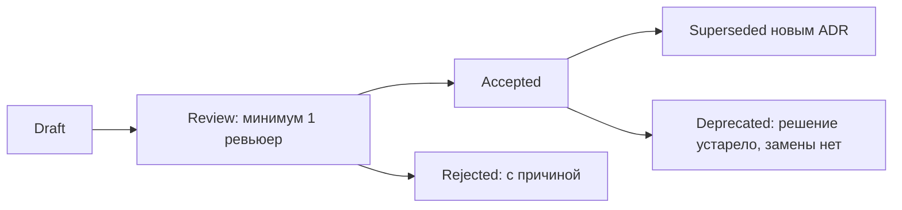

# FluxEngine — ADR-процесс (Architecture Decision Records)

ADR — фиксация значимого архитектурного решения: контекст, варианты, выбор,
следствия. Один ADR = одно решение. ADR — неизменяем после принятия:
изменение = новый ADR со статусом Supersedes.

## Когда обязателен ADR

Триггеры (любой из них — ADR, остальное решается в коде/PR):

1. **Канон**: новое имя крейта/модуля, переименование, изменение структуры
   workspace (правило из [canon.md](../canon.md)).
2. **Контракт**: изменение сигнатуры trait-а из flux-core/contracts
   (Renderer, ScriptVM, NetBackend...), таблиц владения, границ подсистем.
3. **ABI контента**: G-buffer layout, формат .fpf, wire-протокол flux-net,
   формат схем SchemaRegistry, формат треков секвенсора — всё, что ломает
   контент или сеть при смене.
4. **Сквозное правило**: детерминизм, паник-политика, бюджеты, throttling —
   всё, что обязано выполняться более чем одной подсистемой.
5. **Готовые зависимости**: принятие/отбрасывание внешней библиотеки
   (как cpal, glam, mlua — и как Rapier был отброшен).
6. **Отложенное с точкой расширения**: каждая «отложенная фича» с заделом
   получает ADR (моддинг, секвенсор, консольные бэкенды).

Не требует ADR: внутренняя реализация внутри крейта, не меняющая
публичный API и канон; багфиксы; оптимизации в рамках бюджетов.

## Жизненный цикл



- **Draft** — файл `NNNN-slug.md`, дискуссия в PR.
- **Accepted** — мерж; канон/план обновляются этим же PR (канон и ADR — атомарно).
- **Superseded** — новый ADR указывает `Supersedes: NNNN`, старый получает
  ссылку `Superseded by: MMMM`. Старый текст НЕ редактируется.
- **Red-green правило**: ADR мержится вместе с реализацией или до неё;
  «ADR в вакууме» не мержится (как и код без ADR при триггере).

## Шаблон файла

```markdown
# NNNN. Заголовок решения

- Статус: Draft | Accepted | Superseded by MMMM | Deprecated
- Дата: YYYY-MM-DD
- Затрагивает: flux-xxx, flux-yyy (крейты из канона)
- Supersedes: NNNN (если есть)

## Контекст
Какая проблема/сила, почему решение нужно сейчас.

## Варианты
Рассмотренные альтернативы с плюсами/минусами (как в нашей практике:
«своя физика f64 vs Rapier vs масштаб мира»).

## Решение
Что выбрано, одним абзацем + контракты/структуры, если появляются.

## Следствия
Плюсы, минусы/риски, что ломается, какие заделы требуются, этапность.
```

## Дисциплина

- Нумерация сквозная, 4 цифры, slug — кириллица/латиница без пробелов.
- Каждый ADR обновляет [canon.md](../canon.md) (канон/глоссарий)
  и, при необходимости, [architecture.md](../architecture.md) —
  в том же PR.
- Каждый термин из ADR обязан иметь запись в глоссарии канона
  (правило «термин имеет владельца»).

## Индекс (ADR-0001…0027 — архитектурная фаза; 0028…0030 — этап 2; 0031…0033 — этап 3; 0034…0049 — этап 4/инструменты)

| ADR | Решение | Источник |
|---|---|---|
| 0001 | RHI + Vulkan/DX12 (свой слой, не wgpu) | графика |
| 0002 | Собственная архетипная ECS | flux-ecs |
| 0003 | Собственная физика на f64, Rapier не используется | flux-math/physics |
| 0004 | Windows release-цель; Linux dev/CI; консоли — точка расширения | №16 |
| 0005 | flux-graphics: единый крейт, rhi::vulkan/dx12 за feature-гейтами | компоновка |
| 0006 | Крейт-модульная архитектура workspace, 18 единиц канона (16 крейтов + 2 инструмента) | canon.md |
| 0007 | Детерминизм: fixed timestep + seeded-RNG + CI-гейт | №14/№15 |
| 0008 | Координаты: канон i64 → sim f32 floating origin → рендер camera-relative; Reversed-Z | №17 |
| 0009 | Asset-пайплайн: .fpf, flux-assetc, контент-hash UUID | №5/№20 |
| 0010 | SaveState: двухслойная модель мира, flush→fence→evict | flux-scene |
| 0011 | Streaming: ярусы релевантности 0–3, RelevanceSystem на 5 потребителей | flux-net/scene |
| 0012 | Паник-политика: матрица по режимам, job system catch_unwind, FFI | №10 |
| 0013 | Frame pacing: frames-in-flight ≠ swapchain, late-latch, Mailbox | №11 |
| 0014 | Шейдерные пермутации: shader.json, 3 набора keywords, off-demand + fallback | №12 |
| 0015 | Скриптинг: Lua 5.4 mlua, события/команды, instruction limit | №13 |
| 0016 | GraphicsSettings: HardwareTier→Preset→гранулярность, FeatureRegistry | graphics |
| 0017 | G-buffer layout + PBR-модель (GGX Smith h.c., multiscatter) — ABI | №19 |
| 0018 | Тон-маппинг семейство ACES/AgX — художественный ABI | №19 |
| 0019 | flux-build: DAG на content-hash, профили, дельта-патчи, трассировка как версионированный вход | №20 |
| 0020 | Аудио-граф: голоса→шины→мастер, send/return, sidechain, аудио-LOD | №21 |
| 0021 | Тестирование: инвариант-центричная пирамида, golden per-бэкенд, fuzzing, soak | №15 |
| 0022 | Environment/SimTime/weather: данные в сцене, время в симуляции | environment |
| 0023 | Миграции сейвов: SchemaRef/schema_rev, read-time, UUID полей с этапа 1 | миграции |
| 0024 | KCC: чистая функция (state, intention, dt), client-owned, KCC-минимум этап 3, ядро физики этап 6 | flux-physics |
| 0025 | Моддинг: отложено; задел — UUID-резолвинг VFS, слот подписи, правило модифицируемости | №22 |
| 0026 | Секвенсор: отложено; sim-/presentation-треки, маркер трека | секвенсор |
| 0027 | Engine tick/frame/acquire: цикл владеет вызывающий | flux-engine |
| 0028 | flux-macros — служебный proc-macro пакет workspace; приёмка по именованному перечню, не по числу | flux-macros |
| 0029 | Внешние зависимости этапа 2 (criterion/proptest dev-only) + бюджет тика 10k × 3 < 2 мс | flux-ecs |
| 0030 | Формат SchemaRegistry и ComponentDelta: field_uuid, SchemaRef, единая дельта, детерминированный обход | flux-ecs |
| 0031 | Input abstraction: scancode-модель, ActionValue, контексты, Intention-снапшот | flux-platform |
| 0032 | Collision-минимум: тайлы, капсула/луч, свипы, детерминированный обход | flux-physics |
| 0033 | Headless-платформа и детерминизм-харнесс: feature-гейт, same-binary CI | flux-platform/engine |
| 0034 | Vulkan на `ash` (runtime-загрузка, feature `vulkan`), offscreen swapchain; surface — I3, PSO — I5 | flux-graphics |
| 0035 | Shader ABI: SPIR-V, entry points, vertex layout v1, pipeline descriptors | flux-graphics |
| 0036 | Шейдерные пермутации: `shader.json`, keyword-маски, off-demand fallback, кэш трёх уровней | flux-graphics |
| 0037 | GPU query pools: timestamp-пулы RHI, `GpuProfiler::push_from_timestamps` | flux-graphics |
| 0038 | DXC как вендорный тулчейн: LLVM/NCSA, `dxil.dll` из SDK, поиск и атрибуции | flux-assetc |
| 0039 | Дескрипторные наборы (set 0, bindless-массивы), копирование buffer↔image, staging readback | flux-graphics |
| 0040 | `flux-release`: Conventional Commits → semver, CHANGELOG, Cargo.toml, commit/tag; publish и GitHub Release opt-in | tools/flux-release |
| 0041 | Сэмплеры: раздельные `SampledImage` + `Sampler` (DXC/SPIR-V и DX12), combined — только совместимость; `ShaderRead` как единственное состояние чтения | flux-graphics |
| 0042 | GPU-проходы кадра: push constants 64 B, `execute_with`/`compile_with_initial`, G-buffer → SSAO → lighting → bloom → tonemap → TAA, PSNR-эталон от readback предыдущего прохода | flux-graphics |
| 0043 | `.unitypackage` в flux-assetc: gzip/tar (`flate2`, `tar`), staging, `pathname` → дерево `Assets/`, meta рядом, защита от traversal | tools/flux-assetc |
| 0044 | Рантайм-применение `GraphicsSettings`: `FrameFeatures`, `SettingsRuntime`, нейтральные clear отключённых эффектов, `render_scale` в `graph` | flux-graphics |
| 0045 | Образы swapchain как `ImageId`: acquire → `ColorAttachment`, present → `Present`, владение swapchain, инвалидация framebuffer-кэша | flux-graphics |
| 0046 | Копирование buffer→buffer: staging upload в device-local storage, `TRANSFER_WRITE → SHADER_READ` барьер, Null-эмуляция | flux-graphics |
| 0047 | GPU-геометрия сцены: vertex pulling `SV_VertexID`/`SV_InstanceID` из storage-буферов, `GpuFrame::render_scene`, палитра-заглушка | flux-graphics |
| 0048 | UI-stub и present: `frame.ui` читает tonemap/TAA-выход и пишет в acquired-образ swapchain, `GpuFrame::render_to`/`present` | flux-graphics |
| 0049 | Depth-only pipelines и состояние глубины: `DepthCompare`, `PipelineDesc::with_depth_state`, пустые color-форматы при depth-аттачменте (тени, скайбокс) | flux-graphics |

Дополнительные решения, зафиксированные в плане, но не требующие отдельных
ADR-файлов (частично покрыты выше): input abstraction (flux-platform),
undo × PIE × стриминг (flux-editor), golden-сейвы, virtual textures и прочие мелкие —
поднимаются до ADR при первом изменении контракта.

### Уточнения индекса (не изменение решений)

- На момент ADR-0006 число единиц канона — **18** (16 крейтов + 2 инструмента);
  плюс служебный proc-macro пакет `flux-macros` (не единица канона, ADR-0028) —
  workspace members 19.
- ADR-0040 добавляет третий инструмент `tools/flux-release`: актуально
  **19** единиц канона (16 крейтов + 3 инструмента) и **20** workspace members;
  см. канон-таблицу [canon.md](../canon.md). Формулировка ADR-0006 не
  переписывается — ADR неизменяемы.
- Этапность физики: **KCC-минимум — этап 3, ядро — этап 6**; актуальный
  источник — [Roadmap.md](../Roadmap.md). Запись ADR-0024 приведена к ней.
- Этап 4: surface/present перенесён с I3 на **итерацию после I4** (нужен
  оконный handle); I3 — Render Graph, I4 — RenderScene/extract. Запись
  ADR-0034 не переписывается, актуальный источник — [Roadmap.md](../Roadmap.md).
- Surface/present реализованы в 4.2 на `raw-window-handle` 0.6: RHI принимает
  `SurfaceTarget::Window` (win32/xlib/xcb/wayland) и `SurfaceTarget::Headless`
  (`VK_EXT_headless_surface` для CI/lavapipe), `SwapchainDesc::with_surface`
  создаёт настоящий `VkSwapchainKHR`. ADR-0034 допускал `raw-window-handle`
  «при необходимости — отдельный ADR»; отдельный ADR не потребовался:
  контракт I0 не менялся, добавлены методы поверхности. Формулировка
  ADR-0034 не переписывается.
- ADR-0041 закрывает блокер, зафиксированный в ADR-0039 («до отдельного ADR
  по сэмплерам реализуемы только проходы без чтения текстур»): чтение текстур
  разрешено, `CombinedImageSampler` оставлен только для совместимости.
  Формулировка ADR-0039 не переписывается.
- Реализация этапа 4 (Null-часть) уточняет объём «bit-exact CPU-эмуляции»
  из ADR-0039: Null хранит байты изображений, записывает `clear_color` в
  color-аттачменты и обнуляет depth в `begin_render_pass`, переносит байты
  в копиях buffer↔image. Draw/dispatch содержимое не меняют (шейдеры не
  исполняются), поэтому GPU-эталон остаётся на Vulkan. Решения ADR-0039/0041
  не меняются.
- ADR-0042 уточняет границы ADR-0039/0041: чтение текстур используется
  реальными проходами кадра, push constants дополняют дескрипторные наборы
  (а не заменяют uniform-буферы как общий механизм). Формулировки ADR-0039
  и ADR-0041 не переписываются.
- ADR-0043 принимает `flate2` и `tar` только для build-time инструмента
  `tools/flux-assetc`; в рантайм-крейты они не попадают, лицензии уже в
  allowlist `deny.toml`.
- ADR-0045 дополняет ADR-0034/0039: образы `VkSwapchainKHR` регистрируются в
  реестре устройства с `owned: false` и используются как обычные `ImageId`;
  `acquire` больше не переводит образ в `PRESENT_SRC_KHR` (это делает
  `present`). Формулировки ADR-0034/0039 не переписываются.
- ADR-0046 дополняет staging-контракт ADR-0039: host-visible остаются только
  staging-буферы (`write_buffer`/`read_buffer`), а device-local storage
  заполняются `copy_buffer_to_buffer` после `write_buffer`. Формулировка
  ADR-0039 не переписывается.
- ADR-0047 уточняет источник G-buffer-прохода ADR-0042: `GpuFrame::render`
  остаётся процедурным (CPU-эталоны и PSNR), `render_scene` рисует инстансы
  через vertex pulling. Vertex layout v1 из ADR-0035 для сцены не
  используется; формулировки ADR-0035/0042 не переписываются.
- ADR-0046: фактический барьер после `copy_buffer_to_buffer` —
  `TRANSFER_WRITE → SHADER_READ` на стадиях `TRANSFER → VERTEX|FRAGMENT`.
  `VERTEX_ATTRIBUTE_READ` не используется: сцена читает storage-буфер в
  vertex shader, а не через vertex input. Формулировка ADR-0046 не
  переписывается.
- ADR-0048 дополняет ADR-0045/0042: финальный проход `frame.ui` пишет в
  acquired-образ цепочки и не входит в `FRAME_PASS_NAMES` (пул остаётся
  12 запросов). Формат вывода ограничен статическими срезами, пока
  `PipelineDesc::color_formats` статичен: `Bgra8Srgb`, `Rgba8Srgb` и
  `Rgba8Unorm` (headless WSI lavapipe отдаёт только `R8G8B8A8_UNORM`);
  иначе — `Unsupported`. Выбор формата поверхности предпочитает точный
  запрошенный sRGB, затем любой sRGB, поддерживаемый RHI, затем любой
  RHI-формат. Формулировки ADR-0042/0045/0048 не переписываются.
- Проверка ADR-0048: эталон для UI-stub строится через `GpuFrame::render` без
  прохода `frame.ui` (`render_to`/`present` добавляют UI всегда), сравнение
  идёт в линейном пространстве — RGBA16F-выход против фактического формата
  цепочки (sRGB- или UNORM-байты). Панель проверяется по формуле шейдера
  `0.2·scene + 0.016`, а не по «затемнению»: на пустом кадре
  `lerp(0, 0.02, 0.8)` светлее фона. Формулировка ADR-0048 не переписывается.
- FrameStats по пассам добавлен поверх ADR-0042 без нового ADR: `GpuFrame`
  использует query pools из ADR-0037 и отдаёт `GpuZone` через `zones()`,
  `pass_duration_ns()`, `frame_duration_ns()`; цепочка проходов и их форматы
  не меняются. Отдельное решение не требуется — контракт RHI не расширялся.
- ADR-0044 уточняет поведение `GraphicsSettings::diff` из ADR-0016:
  `render_scale` входит в `SettingsChange::graph`, потому что меняет размер
  изображений кадра; флаги `swapchain`/`pipelines` и отсутствие Device в
  `SettingsChange` не меняются. Формулировка ADR-0016 не переписывается.
- Метки `D…` внутри ADR-0041 (`D3`, `D8`) — исторические обозначения работ
  этапа 4; отдельной таблицы долгов больше нет, актуальный порядок — чекбоксы
  этапов 4–7 в [Roadmap.md](../Roadmap.md). Формулировки ADR не переписываются.
- Правило: индекс отражает актуальные числа/этапы; формулировки решений в
  ADR-файлах не переписываются, расхождение оформляется как уточнение здесь.

## Соответствие: сквозные решения ↔ ADR

Сквозные решения в [architecture.md](../architecture.md) нумеруются `№N`,
ADR — `00NN`. Это разные пространства номеров. При добавлении ADR указывайте
номер сквозного решения в колонке «Источник» индекса.

| Сквозное решение | ADR |
|---|---|
| №5 контент-пайплайн | 0009 |
| №7 TransferSystem | 0001, 0005 (реализация внутри flux-graphics) |
| №10 паник-политика | 0012 |
| №11 frame pacing | 0013 |
| №12 шейдерные пермутации | 0014 |
| №13 скриптинг | 0015 |
| №14/№15 детерминизм | 0007, 0021 |
| №16 платформы | 0004 |
| №17 координаты | 0008 |
| №19 G-buffer / PBR / тон-маппинг | 0017, 0018 |
| №20 ассеты и сборка | 0009, 0019 |
| №21 аудио | 0020 |
| №22 моддинг | 0025 |
| №23 миграции схем | 0023, 0030 |
| №24 environment / SimTime | 0022 |
