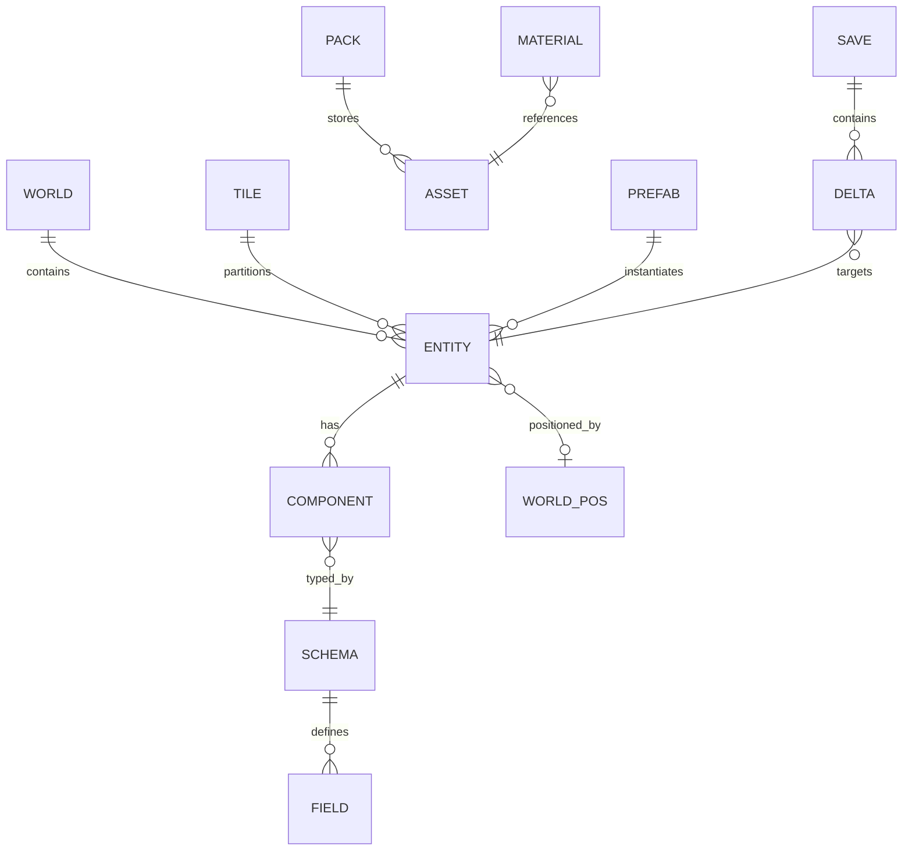

# FluxEngine — Схема данных и контракты

Сводка форматов обмена и правил совместимости. Детали — в
[architecture.md](architecture.md) и [canon.md](canon.md).

## 1. Модель данных (ключевые сущности)

UUID — атрибут идентификации (content-hash для ассетов), а не отдельная
сущность; поэтому в диаграмме он не моделируется узлом.

| Сущность | Идентификатор | Владелец | Хранение |
|---|---|---|---|
| World | UUID | flux-ecs | runtime |
| Entity | index+generation (+UUID для сейвов/сети) | flux-ecs | runtime |
| Component | type_uuid + поля с UUID | SchemaRegistry | runtime/сериализация |
| WorldPos | i64 x3 (нанометры) | flux-math | канон, все форматы |
| Asset | UUID = content-hash | flux-asset | .fpf |
| Tile | грид-координата (целочисленная) | flux-scene | манифест |
| Delta | entity_uuid + component_data + SchemaRef | flux-scene/save | SaveState/journal |
| Prefab | UUID | flux-scene | .fpf |

## 2. Форматы обмена

| Формат | Потребители | Где описан |
|---|---|---|
| `.fpf` контейнер | flux-asset (чтение), flux-assetc (запись) | architecture.md, «Контейнер .fpf» |
| SaveState / journal | flux-scene/save, flux-net persistence | ADR-0030; architecture.md, «SaveState × eviction», «Миграция схем сейвов» |
| Wire-протокол | flux-net | architecture.md, «Сетевой слой» |
| Config (RON) | flux-core/config | architecture.md, flux-core |
| Scene manifest (RON) | flux-scene, редактор | architecture.md, flux-scene |
| `shader.json` | flux-graphics/shaders | architecture.md, «Шейдерные пермутации» |
| Schema (data) | SchemaRegistry | ADR-0030; architecture.md, flux-ecs |
| Sequencer tracks | flux-editor (эт. 6) | architecture.md, «Катсцены / секвенсор (отложено)» |

### .fpf (кратко)
Header (magic, version, offset index) → Index table (UUID, type, offset,
size, xxhash64, compression flags, schema/layout ids, compiler version,
signature slot) → Data blocks (alignment 16/256, header/bulk split) → TOC.

### ComponentDelta (SaveState / сеть / undo)
`ComponentDelta { entity_uuid, schema: SchemaRef, fields: [FieldValue] }`,
`FieldValue { field_uuid, value }` (ADR-0030). Один формат на три потребителя:
SaveState — все `save`-поля (полная запись), сеть — `replicated`-поля
(частичная), undo — изменённые. Порядок полей и дельт — по UUID; неизвестное
поле — `OrphanedField` в лог, не молчаливая потеря. Позиции на проводе —
канон i32/фикс-поинт (квантизация — политика flux-net, не дерайва).

### Wire-протокол (flux-net)
Каналы: ReliableOrdered / UnreliableLatest / Events. Позиция =
ChunkId + i32 offset; ориентация 8/16 бит; никаких f32/f64 для геймплея.

## 3. Версии и обратная совместимость

Принципы (детали — ADR-0023, ADR-0009, ADR-0019):

1. **SchemaRef { type_uuid, schema_rev }** на диске и на проводе;
   рев — версия схемы типа, не игры (ADR-0030).
2. **UUID полей** — идентификатор совместимости с этапа 1: ренейм поля
   не требует миграции; смена типа — новая ревизия. UUID задаётся явно
   или детерминированным seed, случайная генерация запрещена (ADR-0030).
3. **Read-time миграции** по умолчанию: сейвы и журналы не перезаписываются
   при чтении; write-time — осознанная операция обслуживания.
4. **Миграции — цепочки чистых функций**; отсутствующий шаг — ошибка загрузки,
   не молчаливый дефолт.
5. **.fpf**: версия формата в header; несовместимая версия — явный отказ;
   версия компилятора в index table для инкрементальных пересборок.
6. **Wire**: версия протокола в handshake; мод-расширения протокола запрещены.
7. **Удалённые данные**: явное отбрасывание с логом (orphaned-политика),
   молчаливые потери запрещены.
8. **API крейтов**: SemVer движка ([repository-rules.md](repository-rules.md));
   изменение trait-контрактов из flux-core/contracts — только через ADR
   (триггер «Контракт») с bump MINOR/MAJOR по SemVer.

## 4. Правила изменения контрактов

- Любое изменение формата = ADR (триггер «ABI контента») + bump версии
  (schema_rev / format version / protocol version).
- Обратная совместимость обязательна для SaveState и wire; для .fpf —
  пересборка паков допускается (content-hash), но формат-версия обязана
  отвергать старые паки явно.
- Golden-сейвы и golden-паки предыдущих версий — CI-артефакты навсегда.
